<div align="center">

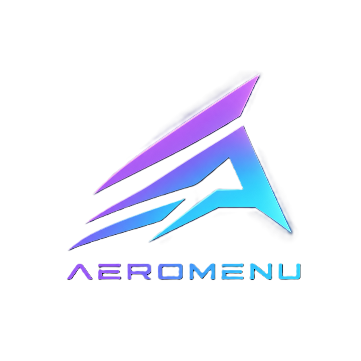

# Aero Menu

**Among Us mod menu with local visual, host, lobby and moderation tools.**

<p>
  
  
  
  
  
</p>

<p>
  <a href="https://github.com/Aero-Apex/AeroMenu/releases/latest">
    
  </a>
</p>

---

[Features](#-features) · [Installation](#-installation) · [Customization](#-customization) · [Config](#-config-files) · [Build](#-build) · [Compatibility](#-compatibility) · [Troubleshooting](#-troubleshooting)

---

</div>

## 📖 About

Aero Menu is a BepInEx IL2CPP mod menu for Among Us.

It uses a custom IMGUI interface and includes local visual tools, player utilities, lobby controls, host features, cosmetics, moderation tools and other experimental options — all searchable from an in-game search tab and rebindable to any key.

Some features are completely local, while others interact with the current lobby and may require host permissions.

## 📸 Screenshots

Captured in-game (Among Us 2026.9.29, BepInEx IL2CPP) with AeroMenu v1.0.4.

<table>
  <tr>
    <td align="center">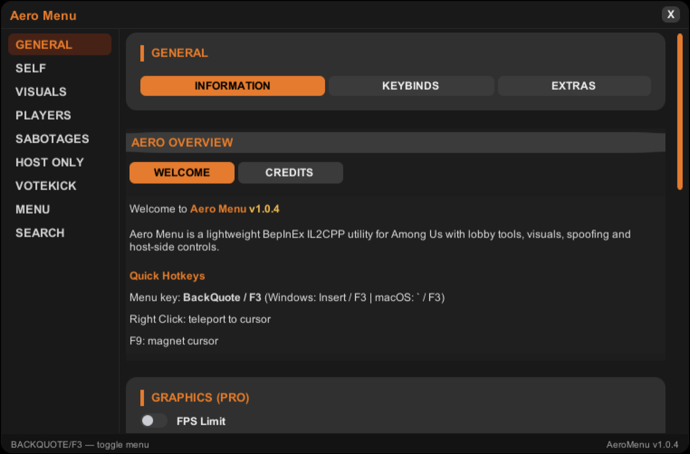<br><sub>General · Information</sub></td>
    <td align="center">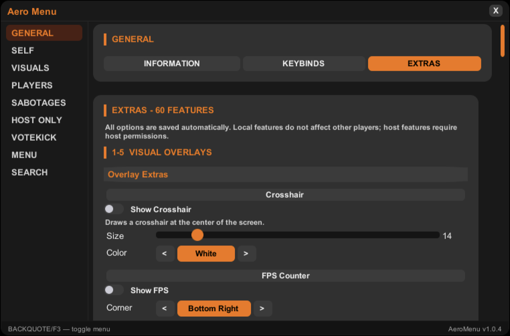<br><sub>General · Extras (60 features)</sub></td>
  </tr>
  <tr>
    <td align="center">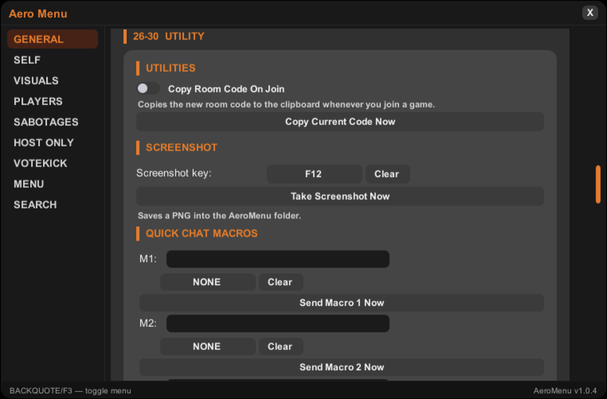<br><sub>Extras · Utility &amp; chat macros</sub></td>
    <td align="center">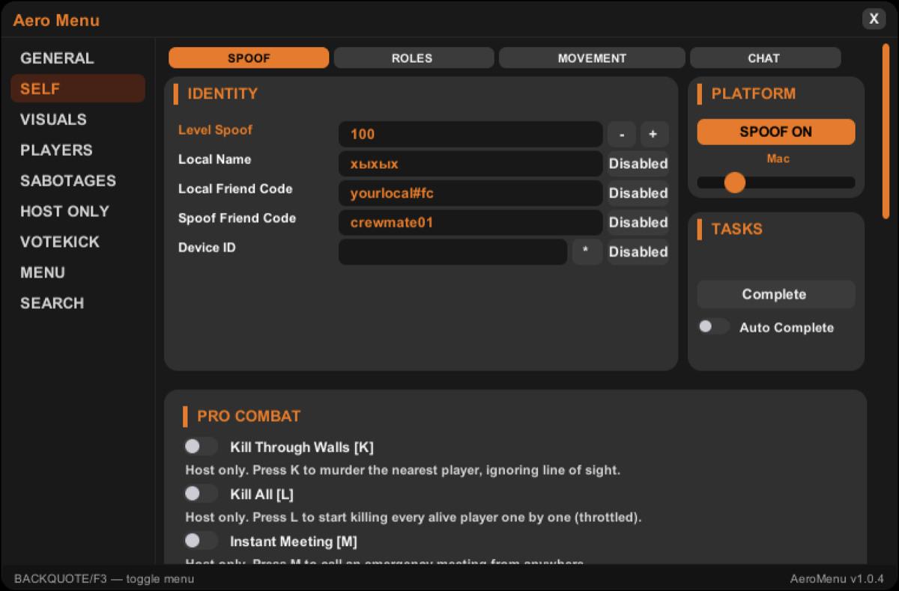<br><sub>Self · Spoof</sub></td>
  </tr>
  <tr>
    <td align="center">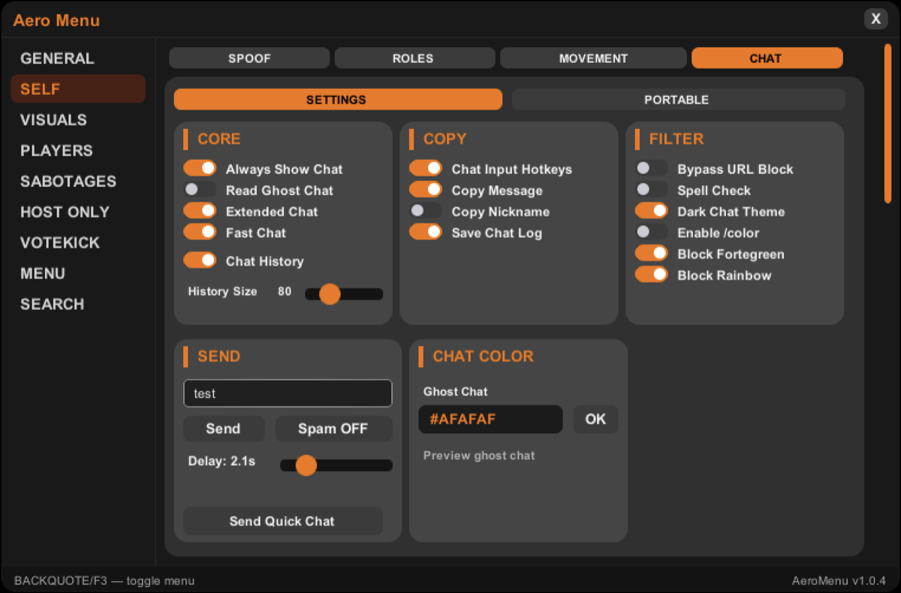<br><sub>Self · Chat</sub></td>
    <td align="center">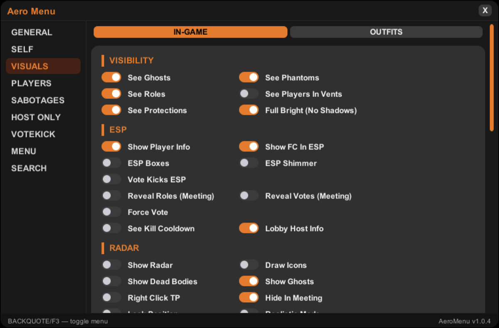<br><sub>Visuals · In-game</sub></td>
  </tr>
  <tr>
    <td align="center">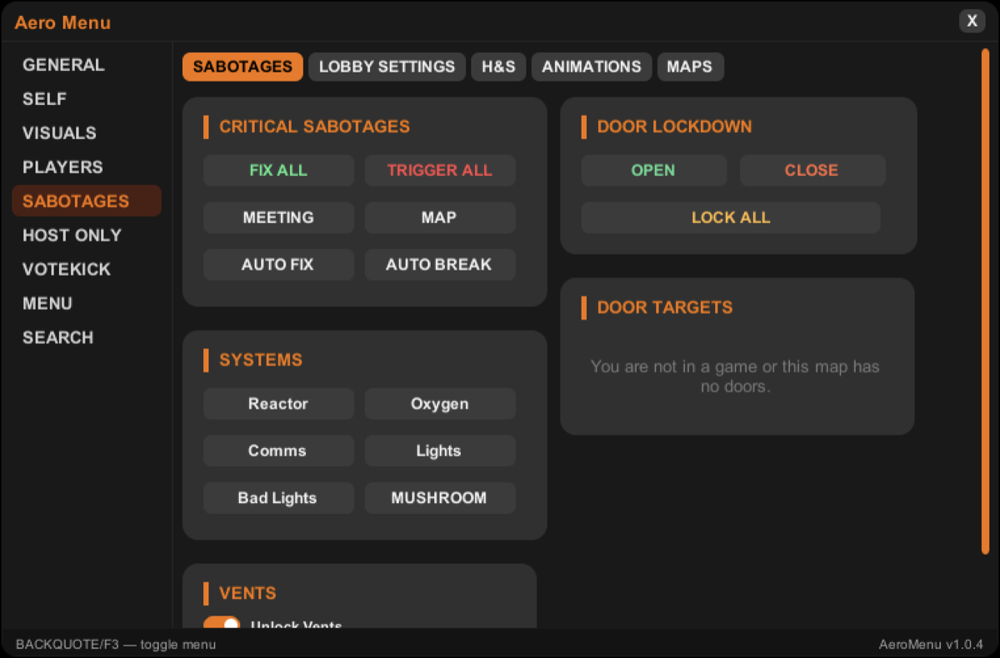<br><sub>Sabotages</sub></td>
    <td align="center">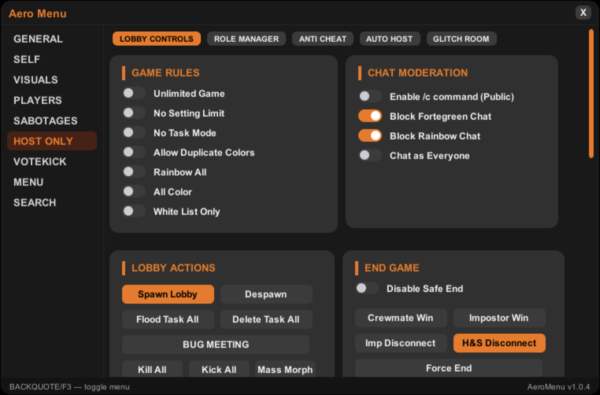<br><sub>Host Only · Lobby Controls</sub></td>
  </tr>
  <tr>
    <td align="center">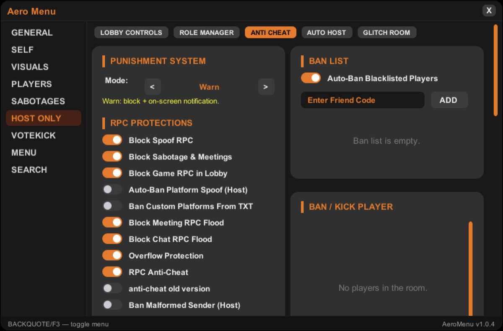<br><sub>Host Only · Anti Cheat</sub></td>
    <td align="center">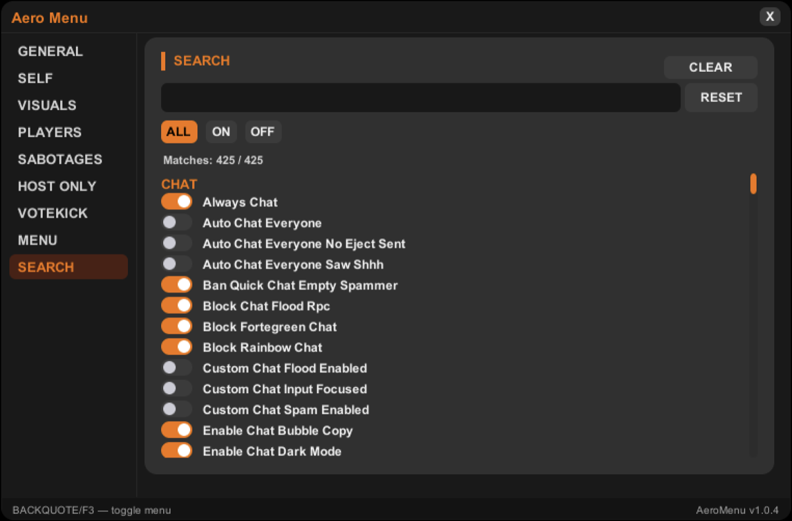<br><sub>Search (every option in one list)</sub></td>
  </tr>
</table>

## ✨ Features

| Category | Features |
| :--- | :--- |
| **Visuals** | ESP, roles, ghosts, vents, tracers, boxes, Full Bright, freecam, zoom, meeting information |
| **Player** | Player info, teleport, follow, morph, revive, kill, clones with 11 formations, Flood Lobby, Bots |
| **Movement** | Speed controls, no-clip and cursor teleport |
| **Outfits** | Random Outfit, favorite outfits, copy outfit, free colors and cosmetic controls |
| **Host** | Lobby management, role manager, task settings, forced roles, start/end controls |
| **Anti-Cheat** | RPC checks, flood protection, bot detection, identity checks, kick/ban actions |
| **Chat** | Extended chat, history, clipboard, whispers, filters, colors, spam/flood and logging |
| **Sabotages** | Trigger/repair sabotages, vents, doors and room controls |
| **Menu** | Themes, backgrounds, RGB accents, notifications, profiles, keybinds, scaling and deep UI customization |
| **EXTRAS (60)** | 60 extra toggles/tools in **General → EXTRAS**: crosshair, FPS/compass/distance overlays, info panels, HUD/FOV/cursor tweaks, host tools, player tools, chat macros, meeting/lobby automation, diagnostics and more |

### 🧩 EXTRAS tab (60 features)

Open **General → EXTRAS** for 60 additional, individually saved options across 12 groups:

1. **Visual overlays** — crosshair, FPS counter, compass, player distance, session clock.
2. **Info panels** — room code, player counts, task progress, meeting timer, connection info.
3. **Local tweaks** — hide HUD, no vignette, custom FOV, free cursor, fullscreen.
4. **Host tools** — freeze players, kill-cooldown override, auto end game, kick no-friend-code, mute all.
5. **Player tools** — TP-to-cursor, push/pull, target speed, auto revive, spin.
6. **Utility** — auto-copy room code on join, screenshot hotkey, chat macros, config backup, auto rejoin.
7. **Panels** — task list, role chart, player status, hotkey reference, FPS graph.
8. **Meeting** — ejection countdown, auto skip vote, auto close meeting, auto report body, meeting cam.
9. **Lobby** — lobby timer, auto start at player count, name-pattern kick, rules preset, room code in status bar.
10. **Cosmetics (local)** — name suffix, rainbow name, player scale, cosmetic spin, color lock.
11. **Diagnostics** — frame-time graph, FPS min/max, memory usage, build info, open config folder.
12. **Automation** — auto open doors, auto fix lights, auto close doors, auto-fill bots, auto refresh lobby.

Host features require host permissions; cosmetic/visual features are local only.

### ⚡ PRO features (50 more)

50 additional features are embedded directly in the existing tabs — no new tabs:
- **MENU**: FPS limiter (e.g. 120), VSync, quality/anti-aliasing override, resolution scale, clipboard tool, real clock, calculator, notes pad, room-code generator.
- **SELF**: **Rejoin Until Impostor** (Roles → Role Tools: copies your lobby settings, hops between nearly full matching public lobbies until you get impostor), kill-through-walls, kill-all, instant meeting, vote immunity, task speed, chat colour/filter/clipboard/highlighter/font options, teleport-by-number, speed hotkeys, camera follow/smooth/zoom, random name/colour/outfit identity tools.
- **VISUALS**: role outlines, name backgrounds, cooldown bars, minimap zoom, dead-body arrows.
- **HOST ONLY**: skip countdown, autoban voters, lobby lock, spectator mode, game presets, ping spoof, host-migration alerts, NetID sanity checks, session/identity logging, auto-ready, auto-exit, screenshot-on-kill, room-code copy, player stats CSV.

### ⌨️ Menu key (platform-aware)

- **Windows / Linux**: `Insert`
- **macOS (including Wine/Crosswire)**: `Command` or `` ` `` (tilde)

The primary and secondary keys are both rebindable in **General → Keybinds**.

### 🔎 Search everything

Type any feature name in the built-in **SEARCH** tab to find it instantly. Filter by category (Visuals, ESP, Radar, Chat, Lobby, Sabotage, Combat, Info, Meeting, Menu) or by On/Off state. Button-only features appear too and jump straight to their tab.

### 💾 Saving & autosave

Your settings are safe:

- Saved on every change, on menu close, and on game exit (**Alt+F4** included)
- Emergency flush on process exit + a full autosave cycle every 30 seconds
- The menu's status bar flashes **Saved ✓** after every save

## 🚀 Installation

> **One-click:** download the release package and run **`Install-AeroMenu.bat`** — it auto-detects your Among Us install (Store / Steam / Epic) or asks for the path, installs BepInEx if missing, and drops in the mod.

<details>
<summary><strong>Manual installation</strong></summary>

### 1. Install BepInEx IL2CPP

Download BepInEx:

- [Stable releases](https://github.com/BepInEx/BepInEx/releases)
- [Bleeding Edge](https://builds.bepinex.dev/projects/bepinex_be)

Use the IL2CPP version matching your game architecture.

### 2. Install BepInEx

Extract it into the Among Us directory containing:

```text
Among Us.exe
GameAssembly.dll
```

Example:

```text
Among Us/
├─ Among Us.exe
├─ GameAssembly.dll
├─ winhttp.dll
├─ dotnet/
└─ BepInEx/
```

Launch the game once and close it after reaching the main menu.

### 3. Install Aero Menu

Download `AeroMenu.dll` from the [Latest Release](https://github.com/Aero-Apex/AeroMenu/releases/latest) and place it here:

```text
Among Us/BepInEx/plugins/AeroMenu.dll
```

### 4. Open the menu

Launch Among Us and press **Insert** (or `Fn + Insert` on some keyboards). The key can be changed later in the menu.

</details>

## 🎨 Customization

Everything is customizable from the in-game **MENU** tab:

| Setting | Options |
| :--- | :--- |
| **Theme** | Light / dark, 82 accent presets, RGB rainbow mode, custom hex accent color |
| **Layout** | Window size & position, scale, corner roundness, sidebar / compact / micro layouts |
| **Look** | Custom backgrounds, menu character, opacity, font size offset, tab animations on/off |
| **Status bar** | Show/hide, custom left text, live "Saved ✓" indicator |
| **Behavior** | Default tab on open, autosave interval, notifications, watermark |
| **Keybinds** | Every action and toggle rebindable, including the menu toggle key |
| **Profiles** | 5 config profiles capturing your whole setup |

## 🗂️ Config files

```text
Among Us/AeroMenu/AeroMenu.cfg
Among Us/AeroMenu/AeroMenuBanList.txt
Among Us/AeroMenu/AeroBotBanList.txt
Among Us/AeroMenu/AeroPlatformBanList.txt
Among Us/AeroMenu/AeroFriendEspIgnore.txt
Among Us/AeroMenu/AeroPlayerHistory.txt
Among Us/AeroMenu/AeroWhiteList.txt
Among Us/AeroMenu/ChatLog.txt
```

## 🧩 Cosmetics

Aero Menu includes local cosmetic options such as:

- Unlock All except Cosmicubes
- Unlock Cosmicubes
- Activate completed Cosmicubes
- Random Outfit
- Free Color
- Favorite outfits

These options do **not** give permanent server-side purchases, currency or account ownership.

## 🐧 Linux / Steam Deck

Install BepInEx and Aero Menu normally, then add this to Steam launch options:

```text
WINEDLLOVERRIDES="winhttp.dll=n,b" %command%
```

## 🔄 Updating

Replace the old `BepInEx/plugins/AeroMenu.dll` with the DLL from the newest release. Your configuration is stored separately and remains unchanged.

## 🛠️ Build

The project targets **.NET 6**.

```powershell
dotnet build .\AeroMenu.slnx -c Release -p:AmongUsDir="C:\Program Files (x86)\Steam\steamapps\common\Among Us"
```

Local Among Us and BepInEx assemblies are resolved through `AmongUsDir`.

A **prebuilt `AeroMenu.dll` is included** in the repository root,
compiled against Among Us **2026.9.29** / BepInEx IL2CPP. Copy it to
`Among Us/BepInEx/plugins/AeroMenu.dll`. If your game version differs, rebuild with
the command above or use `./build-dll.sh "/path/to/Among Us"` — see
[docs/BUILDING.md](docs/BUILDING.md) for details. The `docs/build-dll-workflow.yml` workflow can also build it in CI once copied to
`.github/workflows/` (requires a token with `workflow` scope).

## 🖥️ Compatibility

| Platform                             |           Status          |
| :----------------------------------- | :-----------------------: |
| Steam  / itch.io                     |        ✅ Supported        |
| Epic Games/xbox pc/Microsoft store   |        ✅ Supported        |
| Linux / Steam Deck (Proton)          |        ✅ Supported        |
| Cracked versions                     |        ✅ Supported        |
| iOS / iPadOS / Android               |      ❌ Not supported      |
| PlayStation / Xbox / Nintendo Switch |      ❌ Not supported      |

## ⚠️ Usage

Please use Aero Menu responsibly.

* Use Aero Menu only in private lobbies with players who are aware that mods are being used.
* Some features are local, while others may affect the current lobby or require host permissions.
* If you accidentally join a public lobby, disable or unload the mod before continuing to play.

## 📄 Disclaimer

Aero Menu is an unofficial third-party modification for Among Us.

The project is not affiliated with, endorsed by, sponsored by or approved by Innersloth LLC. Among Us and its related trademarks and assets belong to their respective owners.

Aero Menu is intended for use in **private lobbies only**.

The software is provided **as-is**, without any warranty.

By installing or using Aero Menu, you accept full responsibility for how you use it and for any consequences that may result, including account restrictions, bans, kicks, crashes, lost progress, corrupted files, game instability or incompatibility with future updates.

The developer is **not responsible for any consequences, damage or misuse resulting from the use of this software**.

Support is not provided for harassment, disruption of public games, unauthorized access, moderation evasion or other malicious activity.

## 📜 License

Licensed under the [GNU General Public License v3.0](LICENSE).
